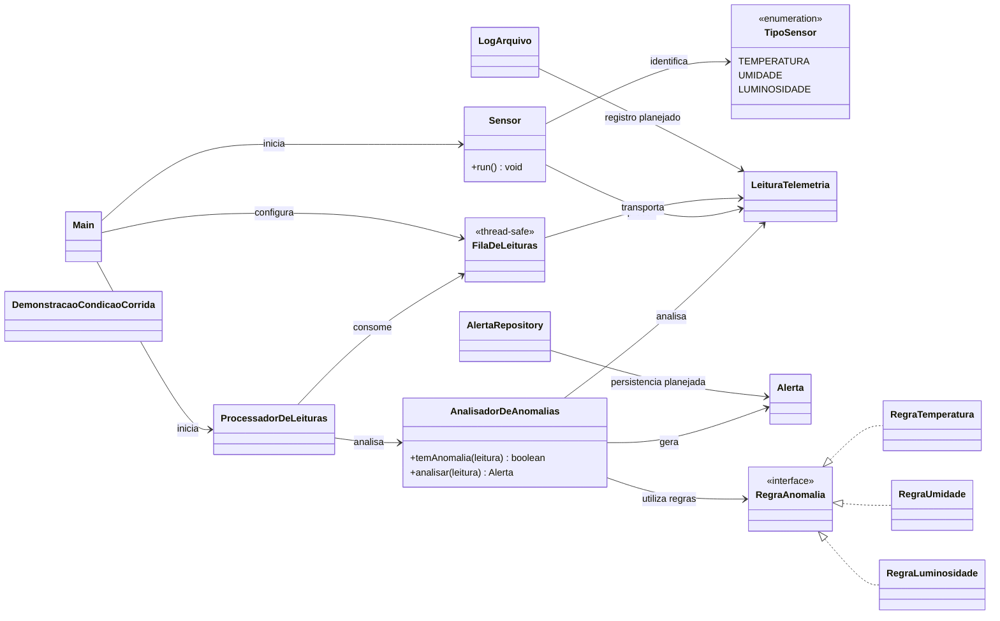

# 🏠 Ninho

**Sistema inteligente de monitoramento de conforto residencial**

O **Ninho** é um projeto desenvolvido para a disciplina de **Programação Orientada a Objetos**, com o objetivo de construir um sistema de recepção e análise de telemetria utilizando **Java**.

O sistema monitora, inicialmente por simulação, três grandezas ambientais:

- 🌡️ **Temperatura**
- 💧 **Umidade**
- 💡 **Luminosidade**

A partir dessas leituras, identifica condições anômalas e gera alertas. O desenvolvimento segue uma evolução incremental, com testes automatizados e versionamento no GitHub.

---

## 🤖 Sobre o projeto

O Ninho aplica conceitos de programação orientada a objetos e concorrência a um cenário de monitoramento residencial.

Além dos sensores simulados, estão **planejadas duas interfaces complementares**:

- **Interface web responsiva:** painel acessível pelo computador e celular, com leituras, alertas e histórico.
- **Interface física embarcada:** matriz de LEDs integrada a um futuro módulo eletrônico com sensores, para representar visualmente estados do ambiente.

A placa controladora (Arduino, ESP32 ou outra), a resolução da matriz e a forma de comunicação serão definidas após a entrega do módulo físico. **Nenhuma dessas interfaces é apresentada como implementada nesta etapa.**

---

## 📋 Requisitos do projeto

O Ninho utiliza como base a proposta **Sistema de Telemetria de Sensores**: sensores produzem leituras em paralelo, uma fila central recebe os dados e um analisador identifica anomalias.

### Requisitos técnicos

- `Sensor` implementa `Runnable`, permitindo executar sensores em threads distintas. **Implementado.**
- Uma fila thread-safe recebe as leituras, utilizando `BlockingQueue`/`LinkedBlockingQueue`. **Implementado.**
- `AnalisadorDeAnomalias` funciona sem depender de threads ou banco de dados. **Implementado.**
- `Alerta` representa os alertas identificados. **Implementado.**
- As regras de anomalia são separadas por tipo de sensor, por meio da interface `RegraAnomalia`. **Implementado.**
- Persistência de alertas via Repository/DAO e JDBC. **Pendente.**
- Registro de todas as leituras em arquivo de log. **Pendente.**
- Pelo menos cinco testes JUnit para as regras de negócio. **Atendido.**
- Separação entre domínio, aplicação e infraestrutura. **Em desenvolvimento contínuo.**

### Rubrica de avaliação

| Critério | Pontuação |
| :--- | ---: |
| Sensores concorrentes sem perda | 1,2 |
| Fila sincronizada e sem deadlock | 1,3 |
| Persistência com JDBC | 1,0 |
| Separação entre domínio e infraestrutura | 0,5 |
| Testes unitários | 0,5 |
| Código e relatório | 0,5 |
| **Total** | **5,0** |

---

## 📊 Regras de anomalia

| Grandeza | Condição considerada anômala |
| :--- | :--- |
| 🌡️ Temperatura | Acima de 30 °C |
| 💧 Umidade | Abaixo de 30% |
| 💡 Luminosidade | Abaixo de 100 lux |

**Observação:** valores exatamente iguais aos limites não geram anomalia. Essas são as regras definidas para a versão atual do projeto.

---

## 🏗️ Estrutura do projeto (evolução incremental)

```text
assistente-de-ambiente/
├── .github/
├── .gitignore
├── AGENTS.md
├── README.md
├── pom.xml
└── src/
    ├── main/
    │   └── java/br/com/assistenteambiental/
    │       ├── app/
    │       │   ├── DemonstracaoCondicaoCorrida.java
    │       │   ├── Main.java
    │       │   └── ProcessadorDeLeituras.java
    │       ├── domain/
    │       │   ├── Alerta.java
    │       │   ├── AnalisadorDeAnomalias.java
    │       │   ├── LeituraTelemetria.java
    │       │   ├── RegraAnomalia.java
    │       │   ├── RegraLuminosidade.java
    │       │   ├── RegraTemperatura.java
    │       │   ├── RegraUmidade.java
    │       │   ├── Sensor.java
    │       │   └── TipoSensor.java
    │       └── infra/
    │           ├── AlertaRepository.java
    │           ├── FilaDeLeituras.java
    │           └── LogArquivo.java
    ├── test/
    │   └── java/br/com/assistenteambiental/
    │       ├── app/
    │       │   ├── ConcorrenciaSensoresTest.java
    │       │   ├── EncerramentoProdutoresTest.java
    │       │   └── SincronizacaoTest.java
    │       └── domain/
    │           ├── AnalisadorDeAnomaliasTest.java
    │           └── RegrasAnomaliaLimitesTest.java
    ├── database/
    │   └── schema.sql
    └── docs/
        └── RELATORIO.md
```

> **Nota:** a presença de `AlertaRepository.java`, `LogArquivo.java`, `schema.sql` e `RELATORIO.md` na estrutura não significa que suas funcionalidades já estejam concluídas. Parte desses arquivos está reservada para as próximas etapas.

---

## 🧩 Arquitetura e diagrama de classes

A aplicação está organizada em três áreas principais:

- **`domain`:** entidades, tipos de sensores e regras de negócio.
- **`infra`:** fila concorrente e componentes de persistência e arquivos previstos.
- **`app`:** inicialização, processamento das leituras e demonstração de concorrência.



O diagrama apresenta as responsabilidades e relações conceituais do sistema. Métodos e dependências específicos devem ser conferidos com o código à medida que novas funcionalidades forem implementadas.

---

## 🧵 Concorrência e sincronização

### Semana 3 — Produtor-consumidor

- Três sensores simulados executam em paralelo como produtores de leituras.
- `FilaDeLeituras` utiliza uma fila thread-safe.
- `ProcessadorDeLeituras` consome as leituras e aplica as regras de anomalia.
- Os testes verificam o processamento concorrente e a quantidade de leituras.

### Semana 4 — Condição de corrida

- `DemonstracaoCondicaoCorrida` compara um contador compartilhado sem sincronização com outro protegido por `synchronized`.
- O incremento `valor++` não é atômico: threads simultâneas podem sobrescrever atualizações.
- O contador sincronizado protege a região crítica; o contador inseguro pode apresentar resultados menores que o esperado, dependendo da execução.
- `SincronizacaoTest` repete dez vezes a validação do contador sincronizado.
- A fila `LinkedBlockingQueue` já oferece segurança para operações concorrentes; não é necessário adicionar `synchronized` manualmente a ela.

A demonstração de condição de corrida é **didática e independente** do fluxo principal de sensores.

### Revisão de robustez antes da publicação da Semana 4

- `Main` e `ConcorrenciaSensoresTest` guardam `Future<?>` e chamam `get()` para detectar exceções das tarefas.
- `Sensor` identifica cada leitura simulada com sequência numérica por tipo; o teste verifica pares `tipo:sequencia` únicos, identificando duplicação ou perda.
- `CountDownLatch` sinaliza o término dos produtores. O consumidor encerra quando todos terminam **e** a fila está vazia, inclusive se a produção for menor que a previsão.
- `FilaDeLeituras` agora oferece `publicar()` e `retirar()`; `getFila()` continua disponível por compatibilidade. A migração completa para encapsulamento pode ser feita futuramente.
- `EncerramentoProdutoresTest` verifica que o consumidor não fica preso quando recebe menos leituras que a quantidade inicialmente prevista.
- A validação anterior registrou **35 testes aprovados**; o teste novo ainda precisa ser validado com `mvn clean test` antes do commit.


---

## 📅 Cronograma e status do desenvolvimento

| Semana | Etapa | Status |
| :---: | :--- | :--- |
| 1 | Domínio básico e regras de negócio (TDD) | ✅ Concluída |
| 2 | Organização em pacotes, regras polimórficas e testes de limites | ✅ Concluída |
| 3 | Threads e execução concorrente dos sensores | ✅ Concluída e publicada no GitHub |
| 4 | Sincronização, estado compartilhado e testes concorrentes | 🧪 Revisão de robustez preparada; revalidar Maven antes do commit |
| 5 | Persistência JDBC e I/O de arquivos | ⏳ Pendente |
| 6 | Testes de estresse e validações finais | ⏳ Pendente |
| 7 | Relatório e vídeo de apresentação | ⏳ Pendente |

---

## 🛠️ Tecnologias utilizadas

- **Java 25**
- **Maven** — gerenciamento de dependências, compilação e execução de testes
- **JUnit 5** — testes unitários e de concorrência
- **Programação Orientada a Objetos** e prática de **TDD**
- **Threads, `Runnable`, `BlockingQueue` e `synchronized`**
- **Git e GitHub** — versionamento

**Planejados para próximas etapas:** JDBC, banco de dados, escrita de logs e interfaces web/física.

---

## 🧪 Como executar e validar

Na pasta raiz do projeto, onde está o arquivo `pom.xml`, execute:

```bash
mvn clean test
```

**Última validação informada (14/10/2026):**

```text
Tests run: 36, Failures: 0, Errors: 0, Skipped: 0
BUILD SUCCESS
```

Os testes automatizados aumentam a confiança no funcionamento, mas não eliminam todos os possíveis problemas de concorrência. A execução de testes de estresse mais amplos está prevista para a Semana 6.

Para observar a condição de corrida, execute a classe `DemonstracaoCondicaoCorrida` pelo VS Code. Ela apresenta três rodadas comparando contadores com e sem sincronização.

---

## 🎓 Contexto acadêmico

Projeto desenvolvido como atividade do **2º Bimestre da disciplina de Programação Orientada a Objetos**, aplicando progressivamente modelagem de domínio, polimorfismo, multithreading, sincronização, testes automatizados, I/O e persistência de dados.

---

## 👨‍💻 Autor

**Guilherme Leal**  
**RA:** 25216067-2
